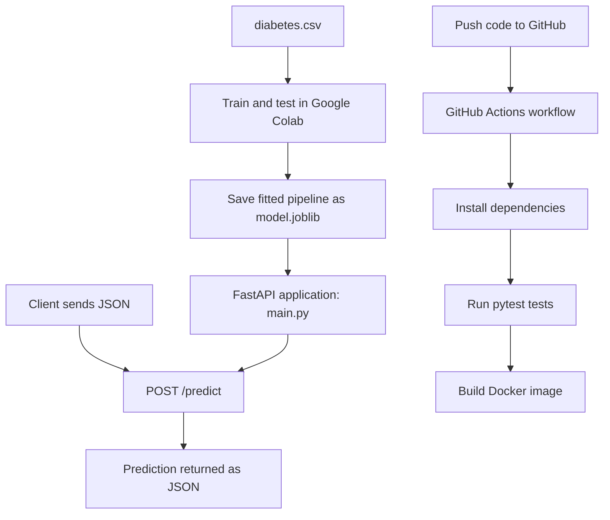

# Diabetes Prediction API

[](https://github.com/jackstealer/diabetes-ml-api/actions/workflows/ci.yml)

An end-to-end machine learning project that predicts a binary diabetes-related outcome from health-related input features. The model is trained with **scikit-learn**, saved with **Joblib**, exposed through a **FastAPI** REST API, packaged with **Docker**, and checked automatically using **GitHub Actions CI**.

> **Educational use only:** This project demonstrates a machine learning deployment workflow. It is not a medical device and must not be used to diagnose diabetes or make healthcare decisions.

## Contents

- [Project Overview](#project-overview)
- [Features](#features)
- [Technology Stack](#technology-stack)
- [Project Structure](#project-structure)
- [Dataset](#dataset)
- [Model Training](#model-training)
- [Run the API Locally](#run-the-api-locally)
- [API Endpoints](#api-endpoints)
- [Run with Docker](#run-with-docker)
- [Run Automated Tests](#run-automated-tests)
- [GitHub Actions CI](#github-actions-ci)
- [Troubleshooting](#troubleshooting)
- [Limitations and Safety](#limitations-and-safety)

## Project Overview

This repository demonstrates a simple end-to-end machine learning workflow:

1. Load and inspect the dataset.
2. Separate input features from the target label.
3. Split the data into training and testing sets.
4. Train and evaluate a Logistic Regression classifier.
5. Save the fitted preprocessing and classifier pipeline to `model.joblib`.
6. Load the saved model in a FastAPI application and expose a prediction endpoint.
7. Build and run the application in a Docker container.
8. Use GitHub Actions to run automated tests and build the Docker image after code changes.

### Architecture



## Features

- Binary classification using Logistic Regression.
- Feature standardization using `StandardScaler`.
- A scikit-learn `Pipeline` keeps scaling and prediction together.
- Model persistence using Joblib.
- REST API endpoints implemented with FastAPI.
- Interactive API documentation generated at `/docs`.
- Docker image build and container-based execution.
- Automated API tests with pytest.
- GitHub Actions workflow for testing and Docker image building.

## Technology Stack

| Technology | Purpose |
|---|---|
| Python | Main programming language |
| Google Colab / Jupyter | Train and evaluate the machine learning model |
| Pandas | Load and manipulate the CSV dataset |
| NumPy | Numerical operations used by the Python ML stack |
| scikit-learn | Train the classifier, scale features, and evaluate accuracy |
| Joblib | Save and load the trained pipeline |
| FastAPI | Build the HTTP prediction API |
| Uvicorn | Run the FastAPI application server |
| Pydantic | Validate incoming request fields and types |
| pytest | Run automated tests |
| HTTPX | Support FastAPI test-client requests |
| Docker | Package and run the API in a container |
| Git and GitHub | Version control and host the source code |
| GitHub Actions | Automatically test the code and build the Docker image |

## Project Structure

```text
diabetes-ml-api/
├── .github/
│   └── workflows/
│       └── ci.yml          # GitHub Actions CI workflow
├── tests/
│   └── test_api.py         # Automated API tests
├── diabetes.csv            # Dataset used for model training
├── main.py                 # FastAPI application and prediction logic
├── model.joblib            # Saved, fitted ML pipeline
├── requirements.txt        # Python dependencies and versions
├── Dockerfile              # Instructions for building the Docker image
└── README.md               # Project documentation
```

A local `.venv/` directory may also exist on your computer. It contains the local Python virtual environment and usually should not be uploaded to GitHub. `__pycache__/` folders are generated by Python and generally do not need to be version-controlled.

## Dataset

This project uses the **Pima Indians Diabetes Database** available on Kaggle:

[Kaggle dataset page](https://www.kaggle.com/datasets/uciml/pima-indians-diabetes-database)

The CSV includes eight input features and a target column named `Outcome`.

| Column | Description |
|---|---|
| `Pregnancies` | Number of pregnancies |
| `Glucose` | Glucose measurement |
| `BloodPressure` | Blood pressure measurement |
| `SkinThickness` | Skin thickness measurement |
| `Insulin` | Insulin measurement |
| `BMI` | Body mass index |
| `DiabetesPedigreeFunction` | Dataset measure related to family history |
| `Age` | Age |
| `Outcome` | Binary target label: `0` or `1` |

The model uses the eight feature columns as inputs (`X`) and `Outcome` as the target (`y`). The target label represents the dataset's recorded class, not a reliable diagnosis for a new individual.

## Model Training

Training is intended to be done in **Google Colab or Jupyter Notebook**, not in VS Code, as required by the project workflow. The trained model is then downloaded and placed beside `main.py`.

### 1. Install the training packages

In a Colab cell, run:

```python
%pip install -q numpy==2.1.3 pandas==2.2.3 scikit-learn==1.6.1 joblib==1.4.2
```

### 2. Upload and load the CSV

```python
from google.colab import files
uploaded = files.upload()  # Select diabetes.csv

import pandas as pd

data = pd.read_csv("diabetes.csv")
print(data.head())
print(data.shape)
print(data.columns)
```

### 3. Prepare features and target, then split the data

```python
X = data.drop("Outcome", axis=1)
y = data["Outcome"]

from sklearn.model_selection import train_test_split

X_train, X_test, y_train, y_test = train_test_split(
    X,
    y,
    test_size=0.2,
    random_state=42,
    stratify=y
)
```

`test_size=0.2` reserves 20% of the rows for testing. `random_state=42` makes the split repeatable, and `stratify=y` aims to preserve the class proportions in both splits.

### 4. Train and evaluate the pipeline

```python
from sklearn.preprocessing import StandardScaler
from sklearn.linear_model import LogisticRegression
from sklearn.pipeline import Pipeline
from sklearn.metrics import accuracy_score

model = Pipeline([
    ("scaler", StandardScaler()),
    ("classifier", LogisticRegression(max_iter=1000))
])

model.fit(X_train, y_train)
y_pred = model.predict(X_test)

print("Accuracy:", accuracy_score(y_test, y_pred))
```

The pipeline first standardizes input features and then passes them to Logistic Regression. The scaler is fitted on the training data only. The test data is used to evaluate the fitted model.

Accuracy is the fraction of test predictions that match the dataset labels. Accuracy alone is not enough to assess a medical prediction model; metrics such as recall, precision, and a confusion matrix would also be appropriate for a more rigorous evaluation.

### 5. Save and download the fitted model

```python
import joblib

joblib.dump(model, "model.joblib")
print("Model saved successfully!")

files.download("model.joblib")
```

Place the downloaded `model.joblib` file in the project root, in the same directory as `main.py` and `Dockerfile`. The file stores the fitted pipeline, including the learned scaling parameters and classifier parameters, so the API does not need to retrain the model at startup.

## Run the API Locally

### Prerequisites

- Python installed on your computer.
- Git (for cloning and version control).
- `model.joblib` present in the project root.

### 1. Clone the repository

```bash
git clone https://github.com/jackstealer/diabetes-ml-api.git
cd diabetes-ml-api
```

### 2. Create and activate a virtual environment

On Windows PowerShell:

```powershell
py -m venv .venv
.\.venv\Scripts\Activate.ps1
```

If PowerShell does not allow activation, you can use Command Prompt instead:

```bat
.venv\Scripts\activate.bat
```

### 3. Install dependencies

```bash
python -m pip install --upgrade pip
pip install -r requirements.txt
```

### 4. Start the FastAPI server

```bash
uvicorn main:app --reload
```

The API will usually be available at:

- Home endpoint: <http://127.0.0.1:8000/>
- Interactive API documentation: <http://127.0.0.1:8000/docs>

Keep the terminal running while you test the API. Press `Ctrl+C` to stop the local server.

## API Endpoints

### `GET /`

Checks that the API is running.

Example response:

```json
{
  "message": "Diabetes Prediction API is running"
}
```

### `POST /predict`

Accepts the eight input features and returns a predicted class and a readable label.

Example request body:

```json
{
  "Pregnancies": 2,
  "Glucose": 120,
  "BloodPressure": 70,
  "SkinThickness": 20,
  "Insulin": 79,
  "BMI": 25.0,
  "DiabetesPedigreeFunction": 0.5,
  "Age": 30
}
```

Example response shape (the actual prediction may differ):

```json
{
  "prediction": 0,
  "label": "Not diabetic"
}
```

The prediction is a class label (`0` or `1`), not a probability. FastAPI validates required fields and types. A malformed request or missing required field may return a validation error.

You can test the endpoint interactively at <http://127.0.0.1:8000/docs>: expand `POST /predict`, select **Try it out**, enter the JSON body, and click **Execute**.

## Run with Docker

### Prerequisites

- Docker Desktop installed and running on Windows, or Docker Engine available on another supported operating system.
- `Dockerfile`, `main.py`, `requirements.txt`, and `model.joblib` in the project root.

### 1. Build the Docker image

Run this from the project root:

```bash
docker build -t diabetes-api .
```

This builds an image using `python:3.11-slim`, installs the dependencies, copies the API code and saved model, and sets Uvicorn as the default startup command.

### 2. Start a container

```bash
docker run --rm -p 8000:8000 --name diabetes-container diabetes-api
```

The `-p 8000:8000` option maps port 8000 on your computer to port 8000 inside the container. Open <http://localhost:8000/docs> and test `POST /predict` again.

If port 8000 is already being used by a local Uvicorn server, stop that server with `Ctrl+C` or select a different host port, for example `-p 8001:8000`, and open <http://localhost:8001/docs>.

The `--rm` option removes the container when it stops. The image remains available unless it is separately removed.

## Run Automated Tests

The tests are in `tests/test_api.py`. They check that:

- `GET /` returns HTTP status `200`.
- `POST /predict` returns HTTP status `200` and a binary prediction (`0` or `1`) for a valid request.

Activate the virtual environment, install the requirements, then run:

```bash
python -m pytest -q
```

Expected result when both tests pass resembles:

```text
2 passed
```

The exact execution time and warning output can vary by environment. A dependency deprecation warning does not automatically mean a test has failed; check the final pytest summary and exit status.

## GitHub Actions CI

The workflow is defined in `.github/workflows/ci.yml`. It is configured to run when code is pushed to `main` or when a pull request targets `main`.

The `test-and-build` job runs on a GitHub-hosted Ubuntu runner and performs these steps:

1. Checks out the repository code.
2. Sets up Python 3.11.
3. Installs packages from `requirements.txt`.
4. Runs the test suite with `pytest -q`.
5. Builds the Docker image with `docker build -t diabetes-api .`.

A green check mark in the repository's **Actions** tab indicates that the workflow job completed successfully. This workflow tests the code and builds an image on the runner; it does **not** deploy the API or publish the Docker image to a registry.

View workflow runs here: [GitHub Actions](https://github.com/jackstealer/diabetes-ml-api/actions).

## Troubleshooting

### `FileNotFoundError: model.joblib`

Make sure `model.joblib` exists in the project root beside `main.py`. The Dockerfile copies this file into the image, so rebuild the image after replacing the model.

### `ModuleNotFoundError` for a package

Activate the correct virtual environment and run:

```bash
pip install -r requirements.txt
```

### `ModuleNotFoundError: No module named 'main'` when running tests

Run tests from the project root using:

```bash
python -m pytest -q
```

The test file also adds the repository root to Python's import path so that it can import `main.py` when pytest collects tests.

### The `/docs` page returns `404 Not Found`

Check that the server started without errors and use the exact URL `http://127.0.0.1:8000/docs` for a local run or `http://localhost:8000/docs` for Docker. Do not add extra characters to the URL.

### Docker cannot connect to its daemon

Start Docker Desktop, wait until Docker is running, then try the build command again.

### Port 8000 is already in use

Stop the other server using the port, or map a different host port, such as `-p 8001:8000`.

### Git push fails

Check the configured remote URL:

```bash
git remote -v
```

It should point to `https://github.com/jackstealer/diabetes-ml-api.git`. If it does not, update it with:

```bash
git remote set-url origin https://github.com/jackstealer/diabetes-ml-api.git
```

## Limitations and Safety

- This is an educational demonstration, not a clinically validated diagnostic system.
- The model's predictions depend on the dataset and training procedure; accuracy on one test split does not prove real-world reliability.
- The API returns a predicted class label, not a calibrated probability or clinical recommendation.
- The basic tests verify endpoint behavior and response format, not the scientific validity or fairness of the model.
- Do not upload private, identifiable, or sensitive health data to this demonstration API.
- Only load `model.joblib` files from sources you trust, because loading serialized Python objects can be unsafe when the file is untrusted.

## Repository

Source code: <https://github.com/jackstealer/diabetes-ml-api>
